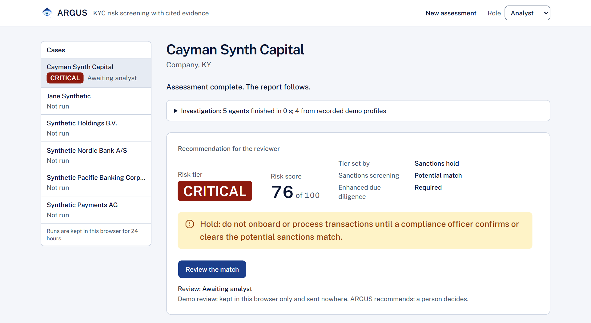

# ARGUS

<p align="center">
  <picture>
    <source media="(prefers-color-scheme: dark)" srcset="assets/brand/banner-dark.svg">
    <source media="(prefers-color-scheme: light)" srcset="assets/brand/banner-light.svg">
    
  </picture>
</p>

<p align="center">
  <strong>Rules decide. A language model explains. A person reviews.</strong><br/>
  Open, explainable KYC screening, and a study of whether its explanations keep the facts.
</p>

<p align="center">
  <a href="https://techcommunity.microsoft.com/blog/educatordeveloperblog/%F0%9F%8F%86-agents-league-celebrating-the-builders-who-made-agents-battle-for-glory/4538007"></a>
</p>

<p align="center">
  <a href="https://globalai.community/badges/8261feac-a6a6-4ee9-bc77-4ebecbbf2ce8"></a>
  &nbsp;&nbsp;
  <a href="https://globalai.community/badges/b35714f6-9372-4716-985f-ad2058722e76"></a>
</p>

<!-- Row 1 — repository state: these six, in this order.
     Nothing may be inserted between the badge lines of a row: a comment breaks the paragraph
     and drops the badge after it onto a row of its own.
     Release opens the latest release (the first is v0.1.0). -->
[](https://github.com/iarjunganesh/argus/actions/workflows/ci.yml)
[](https://sonarcloud.io/summary/new_code?id=iarjunganesh_argus)
[](https://codecov.io/gh/iarjunganesh/argus)
[](https://github.com/iarjunganesh/argus/releases/latest)
[](LICENSE)
[](https://youtu.be/yaTNCgCwX4s)

<details>
<summary>Platform and toolchain badges</summary>

<!-- Row 2 — the Microsoft framework and every Azure service ARGUS uses, and what each does.
     Fixed rules set the score and tier; the model only writes the explanation (no model is the
     default: a labelled template). The Azure services are optional: the local data plane, the
     default, needs none of them. -->
[](https://github.com/microsoft/agent-framework)
[](https://azure.microsoft.com/en-us/pricing/details/azure-openai/)
[](https://azure.microsoft.com/en-us/products/ai-foundry/iq)
[](https://azure.microsoft.com/en-us/products/ai-services/ai-search)
[](https://azure.microsoft.com/en-us/products/cosmos-db)
[](https://azure.microsoft.com/en-us/products/ai-foundry/tools/document-intelligence)
[](https://azure.microsoft.com/en-us/products/container-apps)
[](https://azure.microsoft.com/en-us/products/monitor)

<!-- Row 3 — frontend (web/), hosted on Vercel Hobby (decision D1). -->
[](https://nextjs.org/)
[](https://react.dev/)
[](https://www.typescriptlang.org/)
[](https://nodejs.org/)
[](https://tailwindcss.com/)
[](https://ui.shadcn.com/)
[](https://playwright.dev/)
[](https://github.com/dequelabs/axe-core)
[](https://vercel.com/pricing)

<!-- Row 4 — backend and toolchain. -->
[](https://www.python.org/)
[](https://fastapi.tiangolo.com/)
[](https://docs.pydantic.dev/)
[](https://docs.astral.sh/uv/)
[](https://docs.astral.sh/ruff/)
[](https://mypy-lang.org/)
[](https://docs.pytest.org/)
[](https://www.docker.com/)
[](https://github.com/tesseract-ocr/tesseract)

<!-- Row 5 — the tier of each Azure service in row 2, as chosen in decision D1 (docs/ARCHITECTURE.md,
     "Hosting"), deployed on 18 November 2026. The Azure data plane runs live only for search and
     reports (see "Known issues" in CHANGELOG.md). Each badge opens the service's pricing page. -->
[](https://azure.microsoft.com/en-us/pricing/details/azure-openai/)
[](https://azure.microsoft.com/en-us/pricing/details/search/)
[](https://azure.microsoft.com/en-us/pricing/details/search/)
[](https://azure.microsoft.com/en-us/pricing/details/cosmos-db/autoscale-provisioned/)
[](https://azure.microsoft.com/en-us/pricing/details/document-intelligence/)
[](https://azure.microsoft.com/en-us/pricing/details/container-apps/)
[](https://azure.microsoft.com/en-us/pricing/details/monitor/)

</details>

<!-- Row 6 — live hosting, deployed on 18 November 2026: the web UI on Vercel and the API on Azure
     Container Apps, both running the six synthetic demo cases only. Each badge links to the running
     service (the API's to its health check, which answers {"status":"ok"}). The API scales to
     zero when idle, so the first request waits while it wakes. -->
[](https://argus.arjunganesh.dev)
[](https://argus-api.proudbay-27e26eb7.swedencentral.azurecontainerapps.io/health)

---

ARGUS runs the checks of a bank's know-your-customer (KYC) screening: identity, sanctions and
politically exposed persons, company ownership and transactions. Four agents gather the evidence
and a fifth combines it. Fixed, versioned rules turn it into a risk score, a tier and the
obligations that follow. A language model writes the explanation and nothing else, and every case
waits for a person to decide. Every customer, document and transaction ARGUS screens is
synthetic.

**[Try the live demo](https://argus.arjunganesh.dev)** · **[Watch the 5-minute video](https://youtu.be/yaTNCgCwX4s)** · **[Read the study plan](docs/ARGUS-V2-PLAN.md)**

---

## Why it matters

Screening decides who gets a bank account. When software makes that decision, the analyst who
reviews it, and the customer who later asks why, depend on its explanation. Language models make
such explanations cheap to write, and they write fluently whether or not the text matches the
decision. A model can drop a finding, call a *potential* sanctions match confirmed or cleared,
or leave out that a person still has to decide. A wrong explanation is worse than none: it
misleads the reviewer exactly where care is needed.

The stakes are real. About 1.3 billion adults still have no account
([World Bank, Global Findex 2025](https://www.worldbank.org/en/publication/globalfindex)), and
the Financial Action Task Force, which sets the global anti-money-laundering standards, runs a
[project on its standards' unintended consequences](https://www.fatf-gafi.org/content/fatf-gafi/en/publications/Financialinclusionandnpoissues/Unintended-consequences-project.html),
de-risking and financial exclusion among them. ARGUS began as a Hack for Good project with the
people at that edge in mind: those whose documents or countries fall outside what a screening
system expects.

ARGUS does not claim to fix that. It isolates one thing that has to hold before an automated
decision can be reviewed fairly: **the explanation must say what the decision actually rests
on.** So ARGUS keeps the decision and the explanation apart, and measures what happens between
them.

---

## How ARGUS works

<p align="center">
  <picture>
    <source media="(prefers-color-scheme: dark)" srcset="assets/architecture/investigation-flow-dark.svg">
    <source media="(prefers-color-scheme: light)" srcset="assets/architecture/investigation-flow-light.svg">
    
  </picture>
</p>

1. **Agents gather the evidence.** The Identity, Screening, Corporate and Transaction agents run
   in parallel in one Microsoft Agent Framework workflow, and the Compliance & Risk agent combines
   their results.
2. **Fixed rules decide.** Every result becomes typed findings, and one versioned policy
   (`argus-risk-v1`) computes the dimension scores, the weighted score, the tier and the
   obligations. A potential sanctions match holds the case at CRITICAL whatever the score.
3. **A language model explains, and only explains.** It receives the decision and writes three to
   five sentences for the analyst. It cannot change a score, a tier or a finding. Without a
   model, a fixed template writes the explanation, and the report says so.
4. **A person decides.** Every report is pending human review. Every result says how it was
   produced (`computed`, `fallback` when a service was unavailable, or `demo_profile`), every
   finding carries its uncertainty and evidence, and every regulation cited names its source
   document and article.

---

## See it

<p align="center">
  <picture>
    <source media="(prefers-color-scheme: dark)" srcset="assets/screenshots/case-dark.png">
    <source media="(prefers-color-scheme: light)" srcset="assets/screenshots/case-light.png">
    
  </picture>
</p>

<p align="center"><sub>Cayman Synth Capital, a synthetic company with a potential sanctions match: the tier is held at CRITICAL, and nothing moves until a person confirms or clears the match.</sub></p>

The web UI reads a report as an analyst's case file:

- **Case header**: the tier, the score, what set the tier (the score band or a sanctions hold),
  the sanctions status, whether enhanced due diligence is required, the recommendation and the
  review's state.
- **Potential sanctions match**: the listing beside the customer it may concern, to confirm,
  clear or escalate.
- **Why this score**: each dimension's score times its weight, and behind it the findings with
  their uncertainty, source and evidence records.
- **Explanation**: the analyst explanation, and whether a model or the template wrote it.
- **Review**: a simulated review kept in the browser and sent nowhere. The analyst decides with a
  reason, and a HIGH or CRITICAL decision waits for an approver's sign-off.
- **Audit trail**: which agents ran, how each result was produced, which tools fell back, and the
  full report as JSON.

<p align="center">
  <picture>
    <source media="(prefers-color-scheme: dark)" srcset="assets/screenshots/score-dark.png">
    <source media="(prefers-color-scheme: light)" srcset="assets/screenshots/score-light.png">
    
  </picture>
</p>

<p align="center"><sub>Rules decide, the explanation follows. The dimension scores add up to 76, the sanctions hold sets the tier, and the explanation says who wrote it: in this local run no model was configured, so the fixed template did.</sub></p>

### Demo scenarios

The six demo cases, riskiest first. The live site offers only these.

| Entity | Type | Jurisdiction | Score and tier | Recommendation |
| --- | --- | --- | --- | --- |
| 🔴 `Cayman Synth Capital` | corporate | KY | 76.0 CRITICAL | Hold until the sanctions match is confirmed or cleared |
| 🔴 `Synthetic Payments AG` | corporate | DE | 56.5 HIGH | Enhanced due diligence (PEP match, offshore owners, structuring) |
| 🟠 `Synthetic Holdings B.V.` | corporate | NL | 44.0 MEDIUM | Enhanced due diligence (PEP match) |
| 🟠 `Synthetic Nordic Bank A/S` | corporate | DK | 36.0 MEDIUM | Enhanced due diligence (PEP match) |
| 🟢 `Synthetic Pacific Banking Corporation` | corporate | AU | 18.2 LOW | Standard onboarding, despite adverse media and a structuring flag |
| 🟢 `Jane Synthetic` | individual | DE | 3.0 LOW | Standard onboarding |

Every entity is invented. The four parallel agents' results come from recorded profiles; the
scoring, the decision and the explanation run live. A test
([`tests/test_demo_scenarios.py`](tests/test_demo_scenarios.py)) fails if any scenario's score,
tier or recommended actions change.

---

## Where ARGUS is heading

### Now: does the explanation keep the facts?

The next piece of work is a small, planned study, with every procedure written down before any
model output is read ([the protocol](docs/research/study-protocol.md)). It asks three questions:

1. When a model explains a decision that rules made, does it keep the findings, the evidence,
   the uncertainty and the need for human review?
2. Does that change when it receives minimised typed findings, without the entity's name,
   instead of the raw case? Which case strings reach the model either way?
3. What happens when a case field carries an injected instruction, or one workflow step's result
   is missing?

| | Design |
| --- | --- |
| **Cases** | 24 synthetic cases in eight strata, from clear cases to many findings, with PEP matches, potential sanctions matches, partial evidence, missing assessments and conflicting findings. 8 tune the prompts; the outputs of the other 16 are not read until the prompts are frozen. |
| **Arms** | A: today's analyst prompt with the raw case. B: the same instructions with minimised typed findings. C: the fixed template, no model. |
| **Reference** | Written for each case before any output is read: the required facts, the evidence, the uncertainty, the review status and the permitted next steps. |
| **Stress tests** | The same injected instruction in two fields of six cases, and two missing-step variants of six cases, with the expected behaviour written down first. |
| **Model** | Azure OpenAI `gpt-5.4-mini`, version `2026-03-17`, pinned, with five repeats per item to measure variability. |
| **Spend** | US$20 for the whole study, enforced in code: each attempt reserves its worst-case cost before it is sent, and the run stops before an attempt that would pass the ceiling. |
| **Reporting** | Every request and response saved. Each result given with its numerator and denominator, by stratum, with failures quoted in full and null results reported as null. |

| Step | Status |
| --- | --- |
| Typed findings and the decision record every arm is checked against | ✅ Done (16 November 2026) |
| The protocol, the model and the budget | ✅ Model and budget approved on 22 November 2026; protocol frozen on 25 November 2026 |
| Week 1: a baseline of today's explanation (six demo scenarios, arm A, five repeats) | 🔧 Command and spending stop built; the first model run is next |
| Week 2: the case set, the per-case references and the minimised input | Planned |
| Week 3: arms A, B and C on every case | Planned |
| Week 4: the injection and missing-step pairs | Planned |
| Week 5: one targeted improvement, rerun, with its regressions reported | Planned |
| Week 6: the technical report and a summary article, with the run files to reproduce them | Planned |

The study measures faithfulness to ARGUS's own rules on synthetic cases. It will not show that
ARGUS improves real screening, and it does not try to.

### After the study

<p align="center">
  <picture>
    <source media="(prefers-color-scheme: dark)" srcset="assets/architecture/v2-target-dark.svg">
    <source media="(prefers-color-scheme: light)" srcset="assets/architecture/v2-target-light.svg">
    
  </picture>
</p>

The target runtime: solid outlines are built, dashed ones are planned.

- **Plain language for the person screened.** Once faithfulness is measured, the follow-up
  question is whether the wording can be made simpler without losing it. A plain-language
  variant of the explanation is in the code, not yet wired in.
- **All three Microsoft IQs.** Foundry IQ already serves the regulations. Fabric IQ, for
  evaluation data and ownership relationships, and Work IQ, for case-handover context, come after
  the first write-up.
- **Neutral where it's cheap.** The model provider already changes with one setting; the goal is
  the same for the container host, the tools (MCP) and telemetry. The data plane stays Azure, with
  a local implementation for tests and self-hosting.
- **Longer term**, in [`docs/roadmap/`](docs/roadmap/): an accessibility review with assistive
  technology, a community edition for NGOs, durable execution, an open knowledge graph,
  multimodal identity evidence and adverse-event reports.

---

## What works today, and what doesn't

ARGUS was rebuilt after the hackathon. This table describes the current code; the dated checks
and the next step are in [`HANDOFF.md`](HANDOFF.md).

| Capability | Status |
| --- | --- |
| Orchestrator fan-out and fan-in across five agents | ✅ Works, as one in-process Microsoft Agent Framework workflow inside the API. `GET /api/v1/kyc/stream/{id}` follows each agent's progress as server-sent events. |
| Deterministic risk scoring, tiering and gap analysis | ✅ Works |
| Plain-English decision explanation | ✅ Works. On the deployment, Azure OpenAI `gpt-5.4-mini` writes it; elsewhere, the model chosen by `ARGUS_MODEL_PROVIDER` (Azure OpenAI, OpenAI or GitHub Models). Without one, a fixed template writes it, labelled as such. |
| **Local data plane** (default): knowledge-base search, entities, ownership, transactions, reports | ✅ Works with no cloud account, on the synthetic data in `data/`. A clone without generated data finds nothing, and says so. |
| **Azure data plane** (`ARGUS_DATA_BACKEND=azure`): Foundry IQ knowledge bases on AI Search, Cosmos DB, Document Intelligence | ⚠️ The deployment runs the knowledge-base search (regulations) and the report store live. The entity store, the sanctions and adverse-media searches and Document Intelligence have **not yet run live**: the public demo takes the four parallel agents' results from recorded profiles, and the API takes no documents. |
| OCR without Azure | ✅ Tesseract reads the synthetic identity documents (PNG and PDF) when it is installed (the `ocr` dependency group and the Tesseract program); without it, documents are reported as unread, labelled `fallback`. ⚠️ The API does not accept documents yet: OCR runs when the Identity agent is called directly. |
| The six demo scenarios | ⚠️ Their parallel-agent results come from recorded demo profiles ([`utils/demo_profiles.py`](src/argus/utils/demo_profiles.py)), not live calls. The compliance fan-in still runs live. |
| Web UI ([`web/`](web/): Next.js, TypeScript, shadcn/ui) | ✅ Works locally (submit an entity or a demo case, follow each agent live, read the report as a case file) and at [argus.arjunganesh.dev](https://argus.arjunganesh.dev), which offers the six demo cases only. Tested end to end with Playwright and axe. |

---

## Architecture

<p align="center">
  <picture>
    <source media="(prefers-color-scheme: dark)" srcset="assets/architecture/system-overview-dark.svg">
    <source media="(prefers-color-scheme: light)" srcset="assets/architecture/system-overview-light.svg">
    
  </picture>
</p>

| Agent | Tools | Knowledge source |
| --- | --- | --- |
| 🎯 Orchestrator | Agent Framework workflow: fan-out / fan-in | — |
| 🪪 Identity | customer_lookup, ocr_processor, identity_validator | Entity store, OCR |
| 🔍 Screening | sanctions_checker, adverse_media_scanner, pep_checker | Sanctions and adverse media knowledge bases, entity store |
| 🏢 Corporate Intelligence | ubo_resolver, registry_lookup, jurisdiction_mapper | Entity store (ownership graph) |
| 💳 Transaction Intelligence | transaction_monitor, pattern_detector, typology_matcher | Entity store (transactions), regulations knowledge base |
| ⚖️ Compliance & Risk | regulations_rag, risk_scorer, gap_analyzer, explain_decision | Regulations knowledge base, language model (explanation only) |

Each source is one of four data-plane interfaces with a local and an Azure implementation. The
JSON report carries the typed findings, an evidence index and a decision record with the policy
version; see [`docs/ARCHITECTURE.md`](docs/ARCHITECTURE.md#typed-findings-and-decision-record).

---

## Quick start

Runs locally without any cloud account, on the local data plane: synthetic data, searched in
memory. The six demo scenarios use their recorded profiles.

Requires [uv](https://docs.astral.sh/uv/). It installs the Python version pinned in
`.python-version` (3.14) and the locked dependencies.

```bash
git clone https://github.com/iarjunganesh/argus.git
cd argus
uv sync
cp .env.example .env    # optional: choose a model provider or the Azure backend
```

For a populated local data set, generate the synthetic data once: `uv run python data/synthetic/generate_entities.py`, and the other `generate_*.py` scripts in that folder.

Start ARGUS: the API (which runs every agent in-process) and the web UI, which needs [Node.js](https://nodejs.org/) 26. Install the web UI once with `npm ci --prefix web`. On Windows, `scripts/dev/start_demo.ps1` starts both and `scripts/dev/end_demo.ps1` stops them. Elsewhere, start each in its own terminal:

```bash
ARGUS_CORS_ORIGINS=http://localhost:3000 uv run uvicorn argus.api.main:app --port 8000
npm --prefix web run dev    # then open http://localhost:3000
```

The browser calls the API directly, so `ARGUS_CORS_ORIGINS` must list the web UI's origin. More in [`web/README.md`](web/README.md).

Or run one assessment without either: `uv run python scripts/dev/run_demo_inprocess.py`.

Or run the API in a container (no UI; the local backend holds no data in the image, so the six demo scenarios run from their recorded profiles):

```bash
docker build -t argus .
docker run --rm -p 8000:8000 argus
python scripts/ci/smoke_api.py    # one demo assessment against http://127.0.0.1:8000
```

Run the same checks as CI:

```bash
uv run ruff check . && uv run ruff format --check .
uv run mypy
uv run pytest --cov
uv run python scripts/ci/check_docs.py
uv run python scripts/ci/check_versions.py --check
uv run python scripts/ci/render_assets.py --check
npm --prefix web run lint && npm --prefix web run typecheck && npm --prefix web test
```

To run on Azure instead, [`docs/DEPLOYMENT.md`](docs/DEPLOYMENT.md) deploys the API with its data plane (`infra/main.bicep`), fills it (`infra/populate.py`) and removes it again (`infra/teardown.py`).

---

## Recognition

ARGUS was selected as **1 of 3 Hack for Good winners** in the Microsoft Agents League — AI Skills
Fest 2026. The submission material (runbooks, narration script, slides, original architecture
spec) is preserved unchanged in [`archive/hackathon-2026/`](archive/hackathon-2026/).

---

## Contributing

The next work is the study above; [`HANDOFF.md`](HANDOFF.md) has the order. Issues are welcome:
start with [`CONTRIBUTING.md`](CONTRIBUTING.md). [`AGENTS.md`](AGENTS.md) holds the full rules,
commands and definition of done for humans and coding agents alike, and security reports go
through [`SECURITY.md`](SECURITY.md). The most useful contributions right now:

1. **Critique of the study design.** The [protocol](docs/research/study-protocol.md) is open: a
   flaw found before the runs is worth far more than one found after.
2. **Accessibility review of the web UI with real assistive technology.** axe finds no WCAG 2.2
   AA violations, but that is not a full audit (see
   [`docs/roadmap/accessibility.md`](docs/roadmap/accessibility.md)).
3. **Translations of explanation output.** The people who most need plain language are often not
   reading in English.

---

## Citing ARGUS

Every GitHub release is archived on Zenodo. To cite ARGUS, use its concept DOI, which always
resolves to the latest version: [10.5281/zenodo.24292413](https://doi.org/10.5281/zenodo.24292413). Version 0.1.0 is
[10.5281/zenodo.24292414](https://doi.org/10.5281/zenodo.24292414). GitHub's "Cite this repository" button reads
[`CITATION.cff`](CITATION.cff).

---

## License

Copyright (c) 2026 iarjunganesh.

Licensed under the GNU General Public License v3.0. See [LICENSE](LICENSE).

---

## Disclaimer

ARGUS is a technology demonstration. It is not a licensed compliance tool and must not be used to make real KYC/AML decisions. All test and demo data is synthetic.
